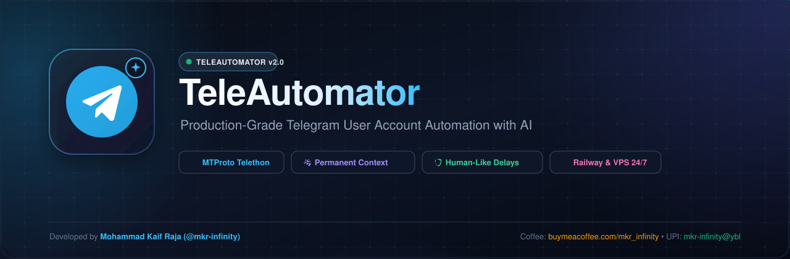

# TeleAutomator — Telegram Chat Automation



[](https://www.python.org/downloads/)
[](https://github.com/LonamiWebs/Telethon)
[](DEPLOYMENT.md)
[](REQUIREMENTS.md)
[](LICENSE)
[](test.sh)

> 🔑 **First Time Setup & Requirements Guide**  
> Wondering which API keys, Telegram IDs, and environment settings are required? Read **[REQUIREMENTS.md](REQUIREMENTS.md)** for a beginner-friendly walkthrough on where to get your `TG_API_ID`, `TG_API_HASH`, bot token, and free AI key.

> 🚀 **Deploying to Railway, Render, or Cloud VPS 24/7?**  
> For complete step-by-step cloud deployment walkthroughs, automated build guides, and environment variable configurations, see **[DEPLOYMENT.md](DEPLOYMENT.md)**.

---

## ⚡ Quickstart (Local)

> 📖 Before starting, configure your credentials in `.env`. See **[REQUIREMENTS.md](REQUIREMENTS.md)** for where to find each value.

```bash
# 1. Clone repository
git clone https://github.com/mkr-infinity/TeleAutomator.git && cd TeleAutomator

# 2. Universal automated setup (installs dependencies and creates .env)
./setup.sh

# 3. Authenticate with your Telegram account (Phone, OTP, 2FA)
./authenticate.sh

# 4. (Optional) Export your headless Cloud session string:
./session.sh

# 5. Start TeleAutomator
./start.sh
```
*(Windows / cross-platform: `python run.py --setup` -> `python run.py --auth` -> `python run.py --session` -> `python run.py`)*

---

## 📱 Telegram Mini App (Web App GUI)

TeleAutomator includes a built-in Telegram Mini App running concurrently on the same server/container without requiring a separate domain or infrastructure.

- **Direct Launch in Telegram**: Registered automatically as the bot's persistent chat menu button (`Open`) via Telegram's `setChatMenuButton` API, and accessible via `/miniapp` inline Web App buttons.
- **Sleek Loading Screen**: Smooth animated startup with glowing project logo, gradient progress bar, and instant state hydration.
- **Overview Dashboard**: Live status pill, 24h reply counters, speaking style, quiet hours schedule, and quick controls (Pause 30m, Resume, Emergency Stop, Mode switch).
- **Chats & Memory Management**: Capsule-style chat cards showing profile initials, titles, allowlist status, per-chat custom personas, voice profiles, and isolated disk context files (`data/contexts/{chat_id}.json`).
- **AI Engine & Testing Playground**: Custom base URL configuration, live model fetch from `/models` endpoints, multi-model selection with automatic fallback rotation, and an interactive test playground.
- **Draft Approvals**: Approve or reject drafts with in-place card updates (zero message deletions on Telegram).
- **Access Control & Paywall**: Multi-user permissions with an automated authorization note (100 Stars or 1 TON to `@mkr_infinity`).

---

## 📑 Operating Modes

Switch modes on the fly from terminal, the Mini App GUI, or your Telegram **Control Bot**:

| Mode | Description | How to Activate |
| :--- | :--- | :--- |
| **`draft`** *(Default)* | Generates and logs drafts to SQLite; **never sends to chat**. | `/mode draft` or `./start.sh --draft` |
| **`approval`** | Sends drafts to your **Control Bot** for `/approve <id>` dispatch. | `/mode approval` or `./start.sh --mode approval` |
| **`restricted_auto`**| Automatically replies to allowlisted chats with human-like delays (min 2.0s between bubbles). | `/mode auto` or set `REPLY_MODE=restricted_auto` |

---

## 📱 Remote Control & Command Reference

Manage your automation straight from your phone by texting your **Control Bot**:

### Permanent Group Context & Memory
| Command | Action | Example |
| :--- | :--- | :--- |
| **`/syncpins [chat_id]`** | Auto-fetches pinned messages from group(s) as permanent context | `/syncpins -1001234567890` or `/syncpins` |
| **`/setcontext <id> <notes>`** | Saves permanent rules/facts for a group so AI never talks nonsense | `/setcontext -1001234 Tech team, building AI agents.` |
| **`/showcontext <chat_id>`** | Inspects active pinned info, notes, AI memory, and isolated disk context file | `/showcontext -1001234567890` |
| **`/delcontext <chat_id>`** | Removes permanent context for a group | `/delcontext -1001234567890` |
| **`/chatprompt <id> <text>`**| Sets an isolated custom AI persona for that specific chat/group only | `/chatprompt -1001234 Speak like a crypto trader` |
| **`/gencontext <chat_id>`** | AI analyzes recent chat banter to create an authentic voice profile | `/gencontext -1001234567890` |
| **`/contextttl <hours>`** | Sets conversation auto-aging window (default: 4.0 hours) | `/contextttl 4.0` |
| **`/clearcontext <chat_id>`** | Resets rolling conversation cache (guaranteed zero Telegram message deletions) | `/clearcontext -1001234567890` |

### Core Controls & Identity
| Command | Action | Example |
| :--- | :--- | :--- |
| **`/status`** | Displays active mode, models, quota, quiet hours, and DataFrame table | `/status` |
| **`/name <name\|sync>`** | Sets display persona name, or syncs automatically from Telegram profile | `/name sync` or `/name Kaif` |
| **`/mode <draft\|approval\|auto>`** | Switches operating mode dynamically | `/mode auto` |
| **`/style <casual\|concise\|formal\|humorous>`** | Changes AI speaking persona on the fly | `/style concise` |
| **`/lang <dynamic\|english\|hindi\|...>`** | Sets target language (dynamic match or forced language) | `/lang dynamic` |
| **`/chats`** | Displays active allowlisted chats in structured DataFrame format | `/chats` |
| **`/allowchat <id>`** | Adds a chat ID to the allowlist directly from phone | `/allowchat 123456789` |
| **`/removechat <id>`** | Removes a chat from allowlist | `/removechat 123456789` |
| **`/mentiononly <on\|off>`** | Reply in groups only when tagged or replied to | `/mentiononly on` |
| **`/miniapp`** | Launches the TeleAutomator Mini App control panel | `/miniapp` |

### AI Models, Quota & Cooldowns
| Command | Action | Example |
| :--- | :--- | :--- |
| **`/aiconfig`** | Inspects provider, base URL, temperature, and reasoning parameters | `/aiconfig` |
| **`/setai`** | Custom AI setup dashboard & 1-line configuration | `/setai <provider> <api_key> [endpoint] [model]` |
| **`/apikey <key>`** | Update active AI API key directly from Telegram without restarts | `/apikey <your_api_key>` |
| **`/baseurl <url>`** | Update custom endpoint URL | `/baseurl https://api.your-provider.com/v1` |
| **`/provider <name>`** | Switch AI engine (`custom`, `gemini`, `openai`, `nvidia`, `local`) | `/provider custom` |
| **`/model <name>`** | Switch AI candidate model (supports comma-separated fallbacks) | `/model <model_name>` |
| **`/usage`** | Displays 24h consumption, total token usage, and remaining free quota | `/usage` |
| **`/checkmodels`** | Pings candidate models live and picks verified working ones | `/checkmodels` |
| **`/reasoning <low\|medium\|high\|off>`** | Adjusts reasoning effort for reasoning-capable models | `/reasoning low` |
| **`/reaction <on\|off>`** | Toggles natural emoji reactions (pool of 26 mobile emojis) | `/reaction on` |
| **`/reactioncooldown <min> <max>`**| Sets randomized reaction interval (default: 3s–9s) | `/reactioncooldown 3 9` |
| **`/chatcooldown <min> <max>`** | Sets randomized per-chat reply cooldown (default: 5s–60s) | `/chatcooldown 5 60` |
| **`/quiethours <on\|off\|start end>`**| Simulates human sleep schedule (pauses replies & reactions) | `/quiethours on 23:00 07:00` |
| **`/stop`** | **Emergency kill switch**: immediately halts all outgoing messages | `/stop` |
| **`/resume`** | Resumes automation and clears all stops/pauses | `/resume` |

---

## 🧪 Testing & Verification

Run the automated test suite locally:
```bash
./test.sh
# Or via universal runner:
python run.py --test
```
**191 passing unit tests** covering configuration, safety guards, quiet hours, randomized cooldowns, permanent context caching, pinned message syncing, adaptive typing, and mock MTProto workflows.

---

## ☕ Support & Donations

If TeleAutomator saves you time or empowers your personal workflow, consider supporting development:

- ☕ **Buy Me a Coffee**: [https://buymeacoffee.com/mkr_infinity](https://buymeacoffee.com/mkr_infinity)
- 🇮🇳 **UPI (India)**: `mkr-infinity@ybl`

---

## 📄 License & Attribution

Licensed under the [Proprietary Source-Available License](LICENSE). Free for personal use.  
Author: **Mohammad Kaif Raja ([@mkr-infinity](https://github.com/mkr-infinity))**
